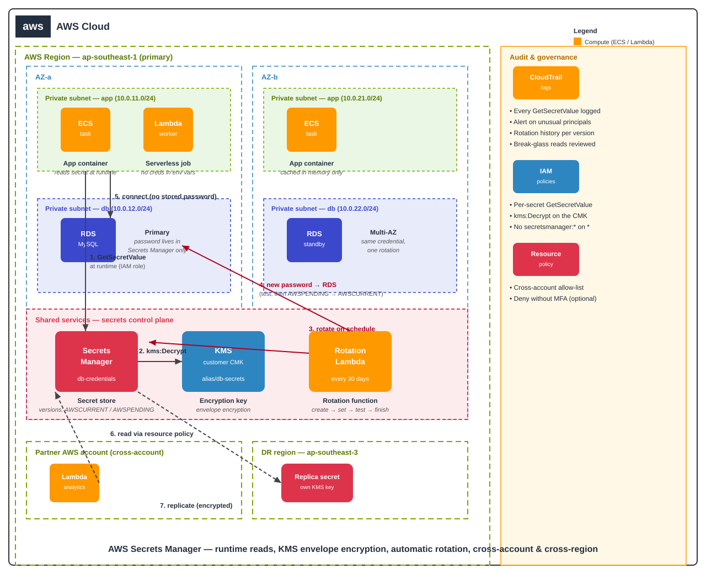

# AWS Secrets Manager Guide — Stop Hardcoding Credentials


> **TL;DR:** Every hardcoded password is a **future incident**: it leaks into git
> history, logs, screenshots, and screenshots-of-screenshots. **AWS Secrets
> Manager** fixes the whole lifecycle — secrets are stored encrypted with a
> **KMS key**, retrieved at runtime with one API call, and **rotated
> automatically** (RDS credentials via a built-in rotation Lambda) without ever
> redeploying your app. Grant access with **IAM policies** (who can read), scope
> cross-account sharing with **resource policies**, and replicate secrets to
> secondary regions for DR. The cheapest incident is the one you never ship.

## Why secrets management is a production gate, not a nice-to-have

A password in an environment variable feels harmless — until it isn't. Real
failure modes, in order of how often they burn teams:

1. **Git history.** `.env` gets committed once, removed later — but the secret
   lives forever in every clone.
2. **Rotation that never happens.** A DB password set in 2023 and shared by 4
   apps can't be changed without a coordinated redeploy. So it never changes.
3. **Blast radius.** One shared credential means one leak compromises every
   service that uses it.
4. **No audit trail.** With env vars, you cannot answer *"who read the prod
   password last Tuesday?"* CloudTrail can.

Secrets Manager addresses all four: encrypted-at-rest storage, versioned
secrets with staging labels (`AWSCURRENT` / `AWSPENDING`), automatic rotation,
and CloudTrail logging on every read.

## Secrets Manager vs the alternatives

| | Secrets Manager | SSM Parameter Store (SecureString) | Hardcoded / env vars | HashiCorp Vault (self-hosted) |
| --- | --- | --- | --- | --- |
| Automatic rotation | **Yes** (built-in for RDS/Redshift/DocumentDB, Lambda template for the rest) | No | No | Yes (plugin-dependent) |
| Encryption | KMS (default AWS key or CMK) | KMS | None | Multiple backends |
| Cost | ~$0.40/secret/month + $0.05/10k API calls | Free (standard), ~$0.05/advanced | Free — until the incident | Free — plus your ops time |
| Cross-region replication | **Built-in** | No (manual) | N/A | Replication add-on |
| Cross-account access | Resource policies | Limited | N/A | Yes |
| Ops burden | Managed | Managed | None | High (HA, backups, upgrades) |
| Best for | **Rotating, audited secrets in AWS** | Config + simple secrets | Local dev only | Multi-cloud, already invested |

**Default choice:** Secrets Manager for anything that needs rotation and audit
(DB credentials, API keys, OAuth tokens). Parameter Store for non-rotating
config like feature flags and AMI IDs.

## Architecture



How a rotation works, step by step:

1. **App reads at runtime, never at deploy time.** ECS task / Lambda / EC2
   calls `GetSecretValue` on startup and caches in memory. No secret in the
   image, the task definition, or the console.
2. **Envelope encryption with KMS.** The secret blob is encrypted with a
   customer-managed KMS key (CMK). You can require separate IAM permission for
   `kms:Decrypt` — so "can read the secret" and "can decrypt it" stay two
   distinct grants.
3. **Rotation without redeploy.** On schedule (e.g. every 30 days), Secrets
   Manager invokes the **rotation Lambda**, which creates a new DB password,
   stores it as the `AWSPENDING` version, verifies connectivity, then flips
   `AWSPENDING → AWSCURRENT`. Apps pick it up on the next read (or via the
   RDS JDBC driver, which retries with both versions during the window).
4. **Cross-account, cross-region.** A **resource policy** on the secret grants
   another AWS account read access; **replication** copies the encrypted secret
   to a DR region with its own KMS key.

> Design rule: a secret is read by code, owned by nobody's laptop, rotated on a
> schedule, and every read leaves a CloudTrail trace.

## The 4 access patterns you must wire correctly

| Pattern | When | How |
| --- | --- | --- |
| Runtime read by compute | Every app, always | IAM policy on the task role / instance profile: `secretsmanager:GetSecretValue` on that secret ARN only |
| Human access (break-glass) | Debugging, DR | Temporary IAM role + `kms:Decrypt`; all reads land in CloudTrail |
| Cross-account service | Central secrets in a security account | **Resource policy** on the secret (`secretsmanager:GetSecretValue` for the consumer account's role) |
| Rotation function | Every rotating secret | Rotation Lambda's execution role: read/write the secret + update the DB user |

**Never do:** wildcard `secretsmanager:*` on `*`. **Always do:** one IAM
statement per secret, plus `kms:Decrypt` scoped to the CMK. Deny-by-default
does the rest.

## Rotation strategies, honestly compared

| Strategy | Mechanics | Downtime risk | Effort |
| --- | --- | --- | --- |
| AWS-managed rotation (RDS, Redshift, DocumentDB) | One-click or Terraform; template Lambda provided | Near-zero (dual-version handshake) | Low |
| Custom rotation Lambda | You write `createSecret` / `setSecret` / `testSecret` / `finishSecret` | Low if you follow the 4-step contract | Medium |
| Manual rotation | Human generates + updates both sides | High (someone forgets the app) | High per rotation |
| No rotation | — | Maximum | Zero — until the breach |

Rotation schedule tip: 30 days for database users, 90 days for API keys, and
rotate **immediately** on any offboarding or suspected leak — the schedule is
hygiene, the incident is the alarm.

## Quick start (Terraform) — see `main.tf`

The included `main.tf` provisions the full pattern:

- KMS CMK with key policy scoped to the secret's rotation role
- Secrets Manager secret with **automatic rotation every 30 days** via the
  RDS-MySQL rotation Lambda template
- IAM role for the app with `GetSecretValue` scoped to that one secret ARN
- Resource policy allowing a partner account read-only access

```hcl
data "aws_secretsmanager_secret_version" "db" {
  secret_id = aws_secretsmanager_secret.db_credentials.id
}

# In your app module — the password never appears in state as plaintext,
# and never in the task definition or user-data.
```

> Apply order matters: create the KMS key first, then the secret, then the
> rotation — Terraform handles this via `depends_on` in `main.tf`.

## Operational checklist

- [ ] No secret in git, env files committed to repos, or container images
- [ ] Each secret has exactly one owning team and one CMK (not the AWS-managed key, for audit granularity)
- [ ] Rotation enabled on every credential that supports it; schedule documented
- [ ] IAM read access scoped per-secret; cross-account via resource policies only
- [ ] CloudTrail data events (or at least management events) alerting on `GetSecretValue` from unusual principals
- [ ] DR: secret replicated to the failover region; rotation Lambda exists there too
- [ ] Break-glass runbook: who can read prod secrets in an incident, for how long, with what approval

## Quiz teaser

Think you've got it? Five scenario questions are waiting in
[`quiz.md`](quiz.md) — including the classic trap: *why does your rotation
Lambda need permission to read the secret it's rotating?*

---

*Part of the cloud engineering notes series — one topic, implemented properly,
every day.*
